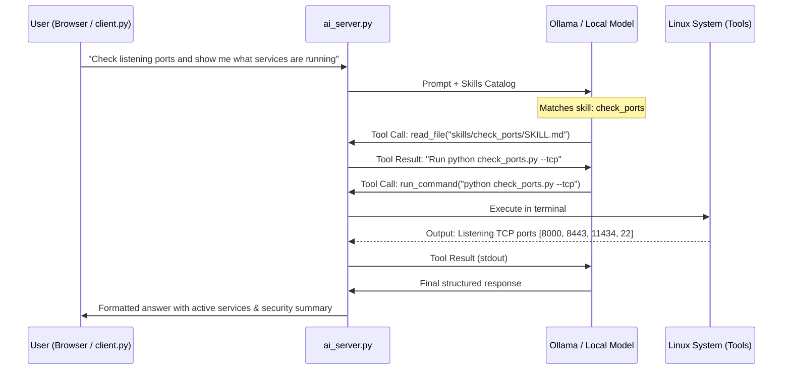

# Skills Knowledge Base & Operational Playbook (`skills.md`)

Welcome to the **Skills System** of the `mystatic` AI platform. This document explains how the dynamic skill catalog works, how the AI agent reads skill playbooks on-demand, and how to trigger and execute every skill from both the **Browser Web Chat** and the **Terminal Client (`client.py`)**.

---

## Table of Contents
1. [Architecture & How Skills Work](#1-architecture--how-skills-work)
2. [How the AI Agent Executes Skills](#2-how-the-ai-agent-executes-skills)
3. [Using Skills from the Browser Chat](#3-using-skills-from-the-browser-chat)
4. [Using Skills from the Terminal Client (`client.py`)](#4-using-skills-from-the-terminal-client-clientpy)
5. [Complete Skills Catalog & Command Mappings](#5-complete-skills-catalog--command-mappings)
   - [System Diagnostics & Defense](#a-system-diagnostics--network-defense)
   - [Reconnaissance & Threat Modeling](#b-reconnaissance--threat-modeling)
   - [Offensive Security & Red Teaming](#c-offensive-security--red-teaming)
   - [Operational Discipline & Workflow](#d-operational-discipline--workflow)
6. [Step-by-Step Prompt Examples](#6-step-by-step-prompt-examples)
7. [Adding and Synchronizing Skills](#7-adding-and-synchronizing-skills)

---

## 1. Architecture & How Skills Work

In `mystatic`, a **Skill** is a modular playbook located in `skills/<skill_name>/SKILL.md`. Each skill teaches the AI model specialized domain knowledge, tactical procedures, command flags, and decision rules.

```
       [ Browser Chat (HTTPS :8443) ]          [ Terminal Client (client.py) ]
                         │                                    │
                         ▼                                    ▼
       ┌──────────────────────────────────────────────────────────────┐
       │                ai_server.py (FastAPI Agent)                  │
       │                                                              │
       │  1. Scans ./skills/*/SKILL.md on every chat request          │
       │  2. Injects catalog summary into System Prompt               │
       │  3. Model detects matching skill playbook                    │
       │  4. Model reads full playbook via read_file tool             │
       │  5. Model executes shell commands via run_command tool       │
       │  6. Model streams structured analysis back to user           │
       └──────────────────────────────┬───────────────────────────────┘
                                      │
                   ┌──────────────────┴──────────────────┐
                   ▼                                     ▼
      [ Local System Tools & OS ]            [ skills/ Directory ]
       - nftables / scapy                     - 40+ specialized playbooks
       - python check_ports.py                - System health & diagnostics
       - df / free / ps / netstat             - Offensive & Defensive tools
```

### Auto-Discovery by `ai_server.py`
When `ai_server.py` boots or receives a request with `enable_tools=True`:
1. It scans the `skills/` directory using `list_skills()`.
2. It parses the YAML frontmatter (`name`, `description`, `command`) from each `SKILL.md`.
3. It formats a lightweight catalog that is appended to the agent's system prompt:
   ```text
   Available Skills Catalog (run read_file on any path below to inspect its full playbook & techniques):
   - check_ports: Check listening TCP and UDP ports and identify active running services (skills/check_ports/SKILL.md)
   - nftables_firewall: Monitor and control unified nftables firewall, ARP neighbor whitelists (skills/nftables_firewall/SKILL.md)
   - sys_health: Check system RAM memory, swap space, disk usage, and CPU load (skills/sys_health/SKILL.md)
   ...
   ```

---

## 2. How the AI Agent Executes Skills

The local AI model (such as `llama3.2:3b` or `qwen2.5-coder:7b`) uses a multi-step autonomous loop:



---

## 3. Using Skills from the Browser Chat

### 3.1. Connect to the Chat
1. Start both backend services:
   ```bash
   python ai_server.py
   python serve_https.py --dir www
   ```
2. Open your browser and navigate to:
   **`https://localhost:8443`** *(or `https://<LAN_IP>:8443`)*
3. Accept the self-signed SSL certificate bypass.

### 3.2. Triggering Skills via the Browser UI
- Simply type your request in natural language. The server automatically includes tool calling and the full skills catalog.
- **Example Inputs:**
  - *"Check all open network ports and report any unauthorized services."*
  - *"Inspect the firewall status using nftables and list any blocked IPs."*
  - *"Check system memory, disk usage, and CPU load."*
  - *"Perform an OSINT reconnaissance plan for target domain example.com."*
- **Voice Input:** Click the microphone (🎤) button, speak your prompt (e.g., *"Check system health"*), and the browser will auto-transcribe and execute the skill.
- **File Attachment (📎):** Attach code, config files, or logs, and ask the model to apply a specific skill (e.g., attach a Python script and ask *"Use code_test to review and test this script"*).

---

## 4. Using Skills from the Terminal Client (`client.py`)

`client.py` allows full access to all skills with real-time feedback showing which tools and files the agent touched.

### 4.1. Interactive Terminal Mode (`-i`)
Launch interactive mode:
```bash
python client.py -i
```
Type any prompt directly:
```text
you> Check system health and tell me if memory is low
[agent thinking / running tools...]

[Tools Executed: 2]
  (1) read_file(path='skills/sys_health/SKILL.md')
  (2) run_command(command='free -h && df -h / && uptime')
----------------------------------------

System Health Report:
- Memory: Total 31 GiB, Used 14 GiB, Available 16 GiB (Healthy).
- Disk: Root filesystem (/) has 280 GiB free out of 450 GiB (62% free).
- Load Average: 0.45, 0.52, 0.48 (Normal).
```

### 4.2. One-Shot Command Execution
Run a skill without entering interactive mode:
```bash
# 1. System port audit
python client.py "Audit listening network ports using check_ports"

# 2. Firewall inspection
python client.py "Check current firewall rules and ARP whitelists"

# 3. Code review & validation
python client.py "Test scripts/buffering.py for syntax errors using code_test"

# 4. Web penetration testing methodology
python client.py "Show the testing workflow for SSRF vulnerabilities from web-pentest"
```

### 4.3. Inspecting Server Capabilities from `client.py`
Verify available tools, backend status, and loaded skills:
```bash
python client.py --list
```
View past conversations stored in `history.db`:
```bash
python client.py --history
```

---

## 5. Complete Skills Catalog & Command Mappings

Here is the complete inventory of the 40+ skills available in this directory:

### A. System Diagnostics & Network Defense

| Skill Folder | Purpose | Core Command / Action |
| :--- | :--- | :--- |
| **`nftables_firewall`** | Live nftables filtering, DoS defense, packet limits, and ARP neighbor whitelisting. | `python firewall-nftables.py --status` |
| **`check_ports`** | Audit TCP/UDP listening sockets, process names, and PIDs. | `python check_ports.py` |
| **`sys_health`** | Check available RAM, swap memory, disk space, and CPU uptime. | `free -h && df -h / && uptime` |
| **`code_test`** | Validate Python syntax, check imports, and run test suites. | `python3 -m py_compile <file>` |

### B. Reconnaissance & Threat Modeling

| Skill Folder | Purpose |
| :--- | :--- |
| **`recon-osint`** | Passive and active target discovery, DNS enumeration, subdomain mapping, and perimeter footprinting. |
| **`threat-hunting`** | Detect anomalous network connections, persistent services, and unauthorized cron jobs. |
| **`threat-model-discipline`**| Structured STRIDE and attack tree threat modeling for infrastructure and code. |
| **`crypto-analysis`** | Audit cryptographic cipher suites, certificate validation, and weak hashing algorithms. |

### C. Offensive Security & Red Teaming

| Skill Folder | Focus Area |
| :--- | :--- |
| **`web-pentest`** | Web application penetration testing (SQLi, XSS, SSRF, IDOR, CSRF, JWT bypass, auth flaws). |
| **`network-attack`** | Network protocol exploitation, routing attacks, ARP/NDP manipulation, and spoofing. |
| **`privesc-linux`** | Linux privilege escalation (SUID binaries, sudo rules, kernel exploits, capabilities, cron jobs). |
| **`privesc-windows`** | Windows privilege escalation (Token privileges, DLL hijacking, unquoted service paths). |
| **`active-directory-attack`** | Kerberoasting, AS-REP roasting, BloodHound paths, DCSync, and domain trust attacks. |
| **`cloud-security`** | AWS, Azure, GCP IAM misconfigurations, metadata endpoint SSRF, and credential leaks. |
| **`container-k8s-escape`** | Docker breakout, container escape vectors, Kubernetes RBAC misconfigurations. |
| **`cicd-supply-chain`** | GitHub Actions, GitLab CI/CD pipeline poisoning, and artifact tampering. |
| **`exploit-development`** | Buffer overflows, ROP chain creation, heap exploitation, and shellcoding. |
| **`shellcode-dev`** | Architecture-specific shellcode generation, encoding, and evasion. |
| **`edr-evasion`** | Process injection, API unhooking, direct system calls, and AMSI bypass. |
| **`malware-analysis`** | Static & dynamic reverse engineering of suspicious binaries and scripts. |
| **`reverse-engineering`** | Ghidra/IDA workflow, binary decompilation, and function analysis. |
| **`wireless-rf`** | Wi-Fi WPA2/WPA3 handshake auditing, deauthentication attacks, and RF analysis. |
| **`mobile-pentest`** | Android & iOS application decompilation, certificate pinning bypass, and storage audits. |
| **`initial-access`** | Phishing payloads, weaponized documents, and perimeter exploitation. |
| **`red-team-ops`** | Command and Control (C2) operations, lateral movement, and persistent access. |

### D. Operational Discipline & Workflow

| Skill Folder | Focus Area |
| :--- | :--- |
| **`opsec-discipline`** | Countermeasures to avoid blue team detection, log sanitization, and traffic stealth. |
| **`scope-discipline`** | Strict engagement boundary verification to prevent unauthorized target interactions. |
| **`finding-discipline`** | Writing high-impact, reproducible vulnerability findings with CVSS scoring. |
| **`incident-response`** | Forensic analysis, memory acquisition, artifact preservation, and breach containment. |
| **`coding-mastery`** | Secure coding standards, modular architecture, and defensive programming. |
| **`using-offensive-claude`**| Rules of engagement and safe ethical guidelines for offensive security assistants. |

---

## 6. Step-by-Step Prompt Examples

### Example 1: Check Open Ports and Services
**From terminal:**
```bash
python client.py "Check listening TCP ports and tell me what is running"
```
**From browser:** Type *"What TCP ports are currently open on this machine?"*
**What happens behind the scenes:**
1. Agent matches `check_ports` from the catalog.
2. Calls `read_file("skills/check_ports/SKILL.md")`.
3. Calls `run_command("python check_ports.py")`.
4. Parses listening ports (`8000`, `8443`, `11434`, `22`) and gives you a clean summary.

---

### Example 2: Inspect and Manage Firewall
**From terminal:**
```bash
python client.py "Show the status of our nftables firewall and list the whitelisted MAC addresses"
```
**What happens behind the scenes:**
1. Agent matches `nftables_firewall`.
2. Calls `read_file("skills/nftables_firewall/SKILL.md")`.
3. Calls `run_command("python firewall-nftables.py --status")`.
4. Shows active nftables tables (`filter`), sets (`whitelist_v4`, `whitelist_mac`, `blacklist_v4`), and confirmed hardware MAC addresses.

---

### Example 3: System RAM and Resource Check
**From terminal:**
```bash
python client.py "How much RAM and root disk space are currently available?"
```
**What happens behind the scenes:**
1. Agent matches `sys_health`.
2. Calls `read_file("skills/sys_health/SKILL.md")`.
3. Calls `run_command("free -h && df -h / && uptime")`.
4. Checks if available RAM is above 1GB and outputs a status report.

---

### Example 4: Testing & Validating a Python Script
**From terminal:**
```bash
python client.py "Test scripts/packet.py syntax and check its dependencies using code_test"
```
**What happens behind the scenes:**
1. Agent matches `code_test`.
2. Calls `read_file("skills/code_test/SKILL.md")`.
3. Calls `run_command("python3 -m py_compile scripts/packet.py")`.
4. Reports syntax validation pass or any errors detected.

---

### Example 5: Web Application Penetration Testing Plan
**From browser or terminal:**
```bash
python client.py "Use the web-pentest skill to outline how to test an API endpoint for IDOR and Broken Object Level Authorization"
```
**What happens behind the scenes:**
1. Agent matches `web-pentest`.
2. Reads `skills/web-pentest/SKILL.md`.
3. Provides authorization header testing patterns, UUID tampering methods, and test case templates.

---

## 7. Adding and Synchronizing Skills

### Synchronizing from Claude Skill Library
If new skills are added to `/home/fuck/.claude/skills/`, sync them automatically:
```bash
python sync_skills.py
```
This automatically links the new playbooks into `./skills/` without requiring a server reboot.

### Creating a New Custom Skill
To create your own skill:
1. Create a folder inside `skills/`:
   ```bash
   mkdir -p skills/my_custom_skill
   ```
2. Create `skills/my_custom_skill/SKILL.md`:
   ```markdown
   ---
   name: my_custom_skill
   description: Brief description of what this skill does and when to invoke it.
   command: python scripts/my_script.py --check
   ---
   # My Custom Skill Playbook

   ### Instructions:
   1. When requested, execute `python scripts/my_script.py`.
   2. Report the output and recommendations.
   ```
3. `ai_server.py` will automatically discover and load it on the next incoming chat prompt!

---

*Document located at `/var/www/html/python/mystatic/skills/skills.md`.*
